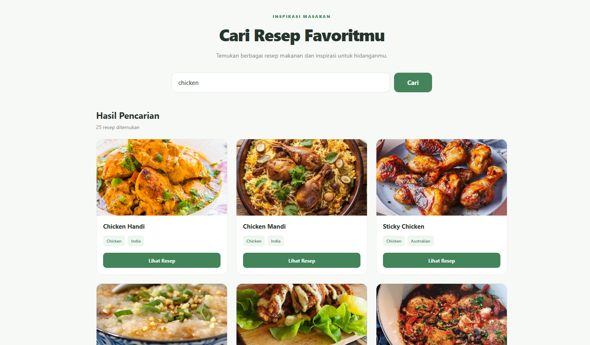

# Recipe Finder

A recipe search web application built with React and Vite. This application allows users to discover recipes, explore ingredients, and read cooking instructions using data from TheMealDB API.

## Live Demo

[View Live Demo](https://react-recipe-finder-eight.vercel.app/)

## Screenshots



## Features

- **Search Recipes** – Search for recipes by food name.
- **Recipe Cards** – Display recipe images, names, categories, and cooking regions.
- **Recipe Details** – View detailed information about selected recipes.
- **Ingredients List** – Display available ingredients and their measurements.
- **Cooking Instructions** – Read instructions for preparing each recipe.
- **YouTube Link** – Open available cooking videos from the recipe details.
- **Loading State** – Display feedback while fetching data.
- **Error Handling** – Handle errors during API requests.
- **Empty State** – Show a message when no matching recipes are found.
- **Responsive Design** – Adapt the interface to different screen sizes.

## Tech Stack

- React
- JavaScript
- Vite
- CSS
- Fetch API
- TheMealDB API

## API Reference

This application uses [TheMealDB API](https://www.themealdb.com/api.php) to retrieve recipe information.

Two main endpoints are used:

### Search Recipes

Search for recipes by name.

```text
https://www.themealdb.com/api/json/v1/1/search.php?s=chicken
```

### Get Recipe Details

Retrieve detailed information using a recipe ID.

```text
https://www.themealdb.com/api/json/v1/1/lookup.php?i=52772
```

## Project Structure

```text
src/
├── components/
│   ├── Header.jsx
│   ├── SearchBar.jsx
│   ├── RecipeList.jsx
│   ├── RecipeCard.jsx
│   └── RecipeDetail.jsx
│
├── App.jsx
├── App.css
├── index.css
└── main.jsx
```

## Getting Started

Follow these steps to run the project locally.

### 1. Clone the repository

```bash
git clone https://github.com/USERNAME/REPOSITORY_NAME.git
```

Replace `USERNAME` and `REPOSITORY_NAME` with your GitHub username and repository name.

### 2. Navigate to the project directory

```bash
cd REPOSITORY_NAME
```

### 3. Install dependencies

```bash
npm install
```

### 4. Run the development server

```bash
npm run dev
```

Open the local URL provided by Vite in your browser.

### 5. Build for production

```bash
npm run build
```

## Learning Objectives

This project was developed as a React learning project to practice:

- React Components
- Props and State
- React Hooks (`useState`)
- Fetch API
- REST API Integration
- Asynchronous JavaScript (`async/await`)
- Promise Handling
- Error Handling (`try/catch/finally`)
- Array Methods (`map`)
- Conditional Rendering
- Component Communication

## Data Source

Recipe information is provided by [TheMealDB](https://www.themealdb.com/).

This application uses an external API and does not have its own backend or database.